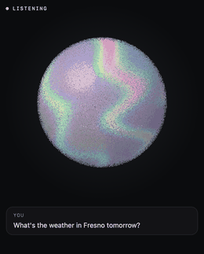
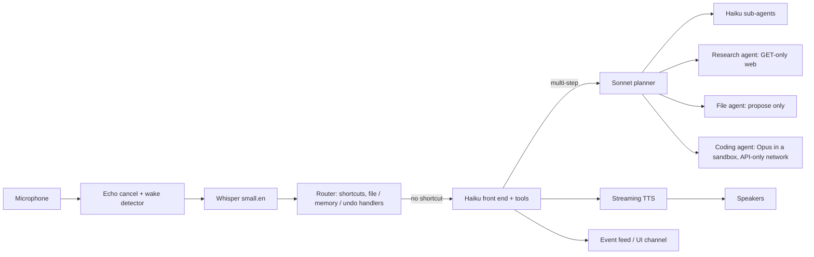

# Julius

A voice assistant for macOS with on-device speech and a Claude brain. Say "Julius" and talk. The wake word, speech recognition and the voice run on your Mac; the thinking is done by Claude (Haiku for conversation, Sonnet for planning, Opus for coding tasks) using your own Anthropic API key. It can look things up, remember what you tell it, tidy your files (always with a preview and a spoken yes), run a sandboxed coding agent, research the web with sources, and be interrupted mid-sentence.

*The orb in the demo is a separate app and is **not included** in this repository. Julius exposes a read-only WebSocket ([docs/EVENT_FEED.md](docs/EVENT_FEED.md)) and an authenticated local write channel ([docs/UI_CHANNEL.md](docs/UI_CHANNEL.md)); the reference UI here is the events client, `python -m julius.ui_bridge.events_client`, which prints the live feed. Anything that speaks those protocols can drive a UI.*

## What it does

| Piece | How |
|---|---|
| Wake word | openWakeWord feature extractor plus a small "Julius" head, then Whisper confirms the word and transcribes the request. A starter model trained on synthetic voices ships in the repo and gets better at *your* voice from normal use (see Passive learning) |
| Speech in and out | MLX Whisper (small.en), an MLX Qwen3-TTS voice, WebRTC echo cancellation so you can talk over it |
| Brain | Claude Haiku 5.5 front end with tools, Sonnet 5.5 planner for multi-step work, offline Ollama fallback when the API is unreachable |
| Agents | file agent (preview, yes, recoverable trash, undo), coding agent (Opus on a sandboxed copy), research agent (read-only web), long-term memory |
| Safety | every write waits for a spoken yes; live facts (scores, prices, weather) must come from a tool call in the same turn; daily spend cap |
| Interfaces | read-only event feed and an authenticated local write channel for a UI |

## Architecture

Code layout: `julius/` is the package (`audio`, `brain`, `agents`, `memory`, `runtime`, `wake`, `ui_bridge`, `service`); `evals/` holds the evaluation suites and baselines; `tests/` the offline unit tests; `docs/` the details.

## Passive learning (wake word)

The shipped wake model is a *starter*: trained only on synthetic voices, with no recordings of any real person. Julius keeps clips of wakes Whisper confirmed (and of rejected fires you repeated), plus rejected fires nobody repeated as negatives, in `~/.julius/wake_personal`. Every 20 new positives a low-priority background job fine-tunes the starter head on them and **keeps the result only if it beats the current model on your own most recent held-out clips**. Nothing is uploaded; `python -m julius.wake.personal forget` deletes every clip and the personal model.

On the author's 60 held-out wake clips (not shipped), at the starter threshold 0.0005: the starter model misses **6 of 60**; a simulation of the personal-learning loop on the author's own earlier clips misses **0 of 60**. Your numbers will differ; the starter is deliberately permissive and Whisper rejects false fires.

## Evaluation results

Numbers come from the author's Mac (M-series, 16 GB) and the suites in `evals/`. Paid suites say so before they run.

| Suite | Result |
|---|---|
| Unit tests (offline) | 897 passing |
| Routing (135 cases) | 97.0% to 97.8% over repeated runs |
| File agent (46 scenarios, deterministic) | 46/46 |
| Live-data guard (14 cases) | 14/14 |
| Memory (commands, forgetting, recall, capture) | all sections pass |
| Planner on a messy Downloads folder (25 runs) | 25/25, nothing protected or recent proposed |
| Coding agent (5 cases incl. injection and push attempts) | 5/5 |
| Research agent (fixture web, 15 runs) | 15/15 accurate, sourced and safe |
| Recorded speech end to end (the author's 20 phrases, not shipped) | 93.1% of turns correct |
| Wake word (60 held-out clips, not shipped) | starter 6 misses; after passive learning 0 |

## Cost per turn (real usage, rates as of 2026-10-24)

| Turn | Typical cost |
|---|---|
| Simple answer or one tool call (Haiku) | about $0.0004 (median of 53 logged turns) |
| Planner turn (Sonnet + sub-agents) | about $0.04 |
| Research task (Haiku, 3 calls) | about $0.0004 on the fixture eval; hard cap $0.10 per task |
| Coding task (Opus, small bugfix) | $0.02 to $0.04; default cap $1.50, hard maximum $5 |
| Day | capped at $5 by default (`[spend] daily_cap_usd`); at 2x Julius switches to the offline model |

## Setup (Apple Silicon, macOS 14+, Python 3.12, 16 GB recommended)

1. Clone, then create the main environment: `python3.12 -m venv .venv && . .venv/bin/activate && pip install -r requirements-cloud.txt`.
2. Create the voice environment (the voice runs as a separate process because its pins conflict with the main environment): `python3.12 -m venv .venv-mlx-tts && .venv-mlx-tts/bin/pip install -r requirements-mlx-voice.txt`.
3. `cp .env.example .env` and paste your `ANTHROPIC_API_KEY` (never committed, never logged). Set a spend cap in the Anthropic console too.
4. Download the models once: `python -m julius.models fetch` (wake-word features, Whisper small.en, the Qwen3-TTS voice; about 3 GB). Without this the first start waits on downloads and the voice worker times out.
5. First run: `python -m julius.profile setup` asks your name, home city and any words Whisper should know (team names, product names), and writes them to `julius.local.toml`, which is gitignored. Skip it and Julius asks for a city the first time you want the weather.
6. Run in the foreground: `python -m julius`, or install as a login service: `python -m julius.service.service on`. Type a request at the prompt or say "Julius".
7. Check it: `python -m julius.service.service doctor`, then `python -m julius.service.service smoke`.
8. Optional, for "look at" requests (what am I holding, what's on my screen): macOS asks for two permissions, once each, the first time you use them. **Screen Recording**: System Settings, Privacy & Security, Screen & System Audio Recording, switch on the Python the service runs (for example `python3.12`), then restart the service (`python -m julius.service.service restart`). **Camera**: allow the prompt that appears on the first camera look (System Settings, Privacy & Security, Camera, `julius-visiond`). Neither is needed for anything else. Details in [docs/PANEL.md](docs/PANEL.md).

Looking at things on request is built in (a camera frame, the frontmost window, the whole screen or a dropped image; see docs/PANEL.md). The always-on perception below is a separate, optional module: it is off and ships without an implementation. To add one, point `JULIUS_VISION_MODULE` at a module exposing `Perception` and `describe`; [Julius Vision](https://github.com/CHZN1/julius-vision) is the companion module (facial-expression recognition today, more senses later).

Music helpers (`julius/music/`, see docs/MUSIC.md) assist with craft and busywork and never generate music or imitate an artist. Today: "what's the BPM / key of kick_loop.wav" (or a file dropped on the orb) measures tempo, key and length on this computer, read-only, and shows a card. Theory help ("what chords go with A minor", "voicings for Cmaj9", "one drop reggae progression", "neo-soul voicings for Dm9", altered dominants like 7#9) computes the notes exactly and shows a piano card. Logic, GarageBand, `/Library/Audio` and plug-in folders are never read.

## Security model

- **Nothing is deleted.** The file agent shows a preview, waits for a spoken yes, and moves files to a recoverable trash with undo. Music, apps, project folders and anything you list as protected are refused. Trash is emptied only on a separate explicit request.
- **Coding agent in a sandbox.** It works on a copy of one project inside a macOS sandbox whose only network route is a local proxy to api.anthropic.com, under a dollar and time cap; merging back is a second preview and a second yes.
- **Research agent is read-only.** GET only, no logins, no forms, page text treated as data not instructions, hard dollar cap per task.
- **Local interfaces only.** The event feed (127.0.0.1:8765) is read-only. The write channel (127.0.0.1:8775) needs a token stored in `~/.julius/ui_token` and every request is audited.
- **Your data stays on your Mac.** Memory, voice recordings, wake clips and logs live under `~/.julius`, `julius_memory/` and `voice_data/`, all gitignored. Logs never contain transcripts or keys by default.
- **Guardrails in the repo.** A pre-commit hook and a CI check refuse committed symlinks; secrets come from the environment only.

## Roadmap

Done: evaluation harness, daily-driver service (wake word, hotkeys, memory, barge-in), file/coding/planner/research agents, voice polish and reliability soak. Next: side-panel results in the UI (charts, images), optional senses (vision on demand, speaker profiles), a better wake model from more synthetic voices, and sports analytics (paused). Details and every measurement: [docs/ROADMAP.md](docs/ROADMAP.md).

## Tests

`python -m unittest discover -p "test_*.py"` (offline). Lint: `ruff check .`. Evals under `evals/` that call paid models say so.

## License

MIT, see [LICENSE](LICENSE). openWakeWord (Apache-2.0) feature models are downloaded at setup; CREMA-D and RAVDESS, used only to train negatives, are not redistributed.
