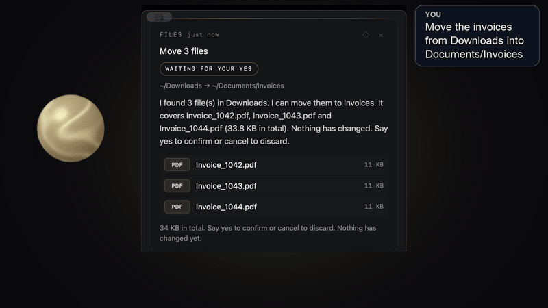
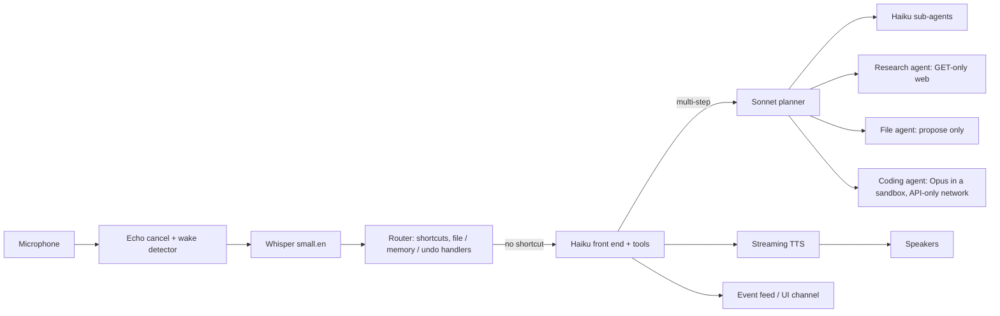

# Julius

[](https://github.com/CHZN1/julius-assistant/actions/workflows/ci.yml)
[](LICENSE)



**[Watch the 60-second demo with sound](docs/media/julius_demo_60s.mp4)** (the GIF above is 10 seconds of it).

Julius is a voice assistant for your Mac that gets things done, not just answers. Say "Julius" and talk, or type. Julius can:
- plan your day and remind you;
- research with real sources and show where every answer came from;
- move your files only after you say yes, and undo it;
- fix a bug in a sandbox and prove the fix with a test;
- read a page you hold up to the camera;
- chart live data;
- hear the tempo and key of your music;
- turn a selfie into a pixel sprite with plain code, no generative AI.

The wake word, speech recognition, the voice and your memory all stay on your Mac. The thinking is done by Claude through your own API key, or by a local model. Most requests cost less than a cent.

> **About the UI:** the orb and side panel in the video are a separate macOS app that is **not open source yet**. This repository is the assistant itself: voice, brain, agents, memory and tools. It runs in a terminal and exposes an authenticated, read-only event feed ([docs/EVENT_FEED.md](docs/EVENT_FEED.md)) and an authenticated local write channel ([docs/UI_CHANNEL.md](docs/UI_CHANNEL.md)), so anything that speaks those protocols can be its UI.

## Features (as in the video)

| In the video | What it does | How |
|---|---|---|
| "Julius" | Wakes on its name and listens | openWakeWord plus a small "Julius" model, confirmed by Whisper; learns your voice from normal use, on your Mac only |
| Calendar and reminders | "What's on my calendar tomorrow?", "Remind me at 3 to send the invoice" | Apple Calendar and Reminders through a local bridge |
| Research with sources | A summary of verified findings, each with a citation to the page it came from | A read-only research agent: GET only, no logins or forms; a claim it can't confirm is left out and it says so |
| Files: yes and undo | "Move the invoices from Downloads into Documents/Invoices" | A preview first, then a spoken or typed yes; a recoverable trash and undo; protected folders refused |
| Page to notes | Hold up a page and get study notes | One camera frame, on request only |
| Error → fix → test | "Read this error on my screen", then a fix with a new test that proves it | A coding agent working on a copy of the project in a macOS sandbox whose only network is the API; merging back needs a second yes |
| "What is this?" | Names a product from a photo and finds where to buy it | Claude vision, plus an optional Google Lens search through SerpApi |
| Live data, charted | "Chart NVIDIA stock this week" | Live facts must come from a tool call in the same turn, never from memory |
| Your music | Tempo, key and the chords that fit | Measured on your Mac (librosa); chord theory computed exactly |
| Selfie to sprite | A PICO-8-style sprite you can edit ("add sunglasses and a cap") | Deterministic image code, no generative model |
| Memory | "What did we decide?" | A local SQLite memory you can list, correct and delete by voice |
| Under 1¢ | Most requests cost less than a cent | Haiku answers, Sonnet plans, Opus codes; a daily spend cap and per-task caps |

Julius can be interrupted mid-sentence (echo cancellation lets you talk over it), and every action that changes something waits for your yes.

## Bring your own models

Each model tier (the voice front end, the planner, the research agent and vision) can run on Anthropic, on a model you serve through [Ollama](https://ollama.com), or on any OpenAI-compatible endpoint: LM Studio, llama.cpp `llama-server`, vLLM, OpenRouter or Ollama's `/v1`. With no extra settings everything runs on your own Anthropic API key, exactly as before.

It's meant for large models (roughly 70B-class) on your own hardware or a strong hosted open model: small laptop-sized models are measured below the floors Julius needs. An example config (not tested here: no large model has been measured yet), with a large model your Ollama server already has, in `julius.local.toml`:

```toml
[models.front_end]
provider = "ollama"
model = "llama3.3:70b"
```

Every cost-ledger row records which provider and model answered (your own hardware costs $0). The evals run against any provider, for example `python evals/run_all.py --provider ollama --model <your model> --tier front_end --workers 1`. [docs/PROVIDERS.md](docs/PROVIDERS.md) covers every provider, the per-tier settings, what each provider can and can't do, the floors a model must reach, and the measured results. The coding agent still uses `claude -p`; its own edit/test loop for other models is planned there.

## Install (macOS)

**Requirements**
- A Mac with Apple silicon (M1 or later), macOS 14 or later, and 16 GB of memory recommended.
- Python 3.12. If `python3.12 --version` fails, install it with `brew install python@3.12`.
- About 6 GB of free disk space for the environments and models.
- An [Anthropic API key](https://console.anthropic.com/), or [Ollama](https://ollama.com) for local-only use.

**Steps**

1. Clone and create the main environment:
   ```bash
   git clone https://github.com/CHZN1/julius-assistant.git
   ```
   ```bash
   cd julius-assistant && python3.12 -m venv .venv && .venv/bin/pip install -r requirements-cloud.txt
   ```
2. Create the voice environment. The voice runs as a separate process because its pinned packages conflict with the main environment:
   ```bash
   python3.12 -m venv .venv-mlx-tts && .venv-mlx-tts/bin/pip install -r requirements-mlx-voice.txt
   ```
3. Add your API key. Copy the example and paste your key after `ANTHROPIC_API_KEY=`. The file is gitignored, and the key is never logged:
   ```bash
   cp .env.example .env && open -e .env
   ```
   Set a monthly spend limit in the Anthropic console too. Julius also has its own daily cap (`[spend] daily_cap_usd` in `julius.toml`, $5 by default).
4. Download the models once: the wake-word features, Whisper small.en and the voice, about 3 GB. Without this step, the first start waits on downloads.
   ```bash
   .venv/bin/python -m julius.models fetch
   ```
5. Tell Julius your name, home city, and any words Whisper should know (team or product names). They are saved in `julius.local.toml`, which is gitignored. You can skip this step.
   ```bash
   .venv/bin/python -m julius.profile setup
   ```
6. Start Julius in the terminal:
   ```bash
   .venv/bin/python -m julius
   ```
   When you see `julius ready`, say "Julius" or type a request and press Return. Type `/stop` to interrupt and `/quit` to exit.

**Permissions** (macOS asks once each, the first time something needs them):
- **Microphone:** for the terminal app you run Julius from (Terminal, iTerm…). Needed to talk to Julius; typing works without it.
- **Calendars and Reminders:** the first time you ask about your calendar or set a reminder.
- **Camera:** the first time you ask Julius to look at something (for example `julius-visiond`).
- **Screen Recording:** only for "what's on my screen" / "read this error". Turn it on for your terminal (or for the Python the service runs) in System Settings → Privacy & Security → Screen & System Audio Recording, then restart Julius.

The stop and wake hotkeys (Ctrl+Option+S and Ctrl+Option+J) need no permission.

**Optional extras**
- **Run at login as a background service:**
  ```bash
  .venv/bin/python -m julius.service.service on
  ```
  Then check it with `.venv/bin/python -m julius.service.service doctor` and `… smoke`. `… off` removes it.
- **Product search from a photo:** put a [SerpApi](https://serpapi.com) key in `.env` as `SERPAPI_KEY`. Without it, nothing is sent to SerpApi.
- **Your own models:** to run Julius on a large model you host yourself, or on a hosted open model, see [docs/PROVIDERS.md](docs/PROVIDERS.md). Small laptop-sized models are measured below the floors Julius needs, so this is for large setups (roughly 70B-class).
- **Works without internet (limited):** when the API can't be reached, Julius can fall back to a small local model (`[offline] model`, `llama3.2:3b`) if you have [Ollama](https://ollama.com) and that model installed. It is a stopgap only: it handles simple questions, but it often picks the wrong tool and can state live figures it hasn't fetched. Without it, Julius says it can't answer until the connection is back.

**Give it another name:** set `name` under `[identity]` in `julius.toml` (or in your own `julius.local.toml`), then restart. The new name is used in:
- the prompts and the spoken replies;
- the cards and the console lines;
- the wake check;
- the orb's title and speaker label.

The trained wake-word model only knows "Julius". Until you train one for the new word (`python -m julius.wake.build_dataset`, then `python -m julius.wake.train_head`), Julius falls back to the Whisper wake, which already listens for the new name but uses more CPU. Folder names such as `~/Julius Saved` and `~/Library/Logs/Julius` stay as they are, so renaming never moves your data. Details are in [julius/identity.py](julius/identity.py).

More detail on each feature is in [`docs/`](docs/). For example: the side panel and looking at things ([PANEL.md](docs/PANEL.md)), music ([MUSIC.md](docs/MUSIC.md)), the file agent ([File_Agent.md](docs/File_Agent.md)), and voice modes ([Voice_Modes.md](docs/Voice_Modes.md)).

## Architecture



The code is laid out like this:
- `julius/`: the package (`audio`, `brain`, `agents`, `memory`, `runtime`, `wake`, `ui_bridge`, `service`).
- `evals/`: the evaluation suites and baselines.
- `tests/`: the offline unit tests.
- `docs/`: the details.

## Security model

- **Nothing is deleted.** The file agent shows a preview, waits for a yes, and moves files to a recoverable trash with undo. Music, apps, project folders and anything you list as protected are refused.
- **The coding agent works in a sandbox,** on a copy of one project. Its only network route is a local proxy to api.anthropic.com, and it runs under a dollar and time cap. Merging back is a second preview and a second yes.
- **The research agent is read-only:** GET requests only, no logins, no forms. Page text is treated as data, not instructions, and each task has a hard dollar cap.
- **Local interfaces only.**
  - The event feed (127.0.0.1:8765) is read-only and needs the same token as the write channel, so other programs on your Mac can't read the transcript.
  - The write channel (127.0.0.1:8775) needs a token stored in `~/.julius/ui_token`, and every request is audited.
- **Model endpoints you add are checked.** Plain `http://` is allowed only to this Mac; another machine needs `https://` unless you set `allow_insecure = true` for that tier, which Julius warns about at every start. Ollama (port 11434) has no authentication of its own, so keep it bound to localhost; Julius warns if a configured Ollama endpoint is on another machine without https. See [docs/PROVIDERS.md](docs/PROVIDERS.md).
- **Your data stays on your Mac.** Memory, recordings, wake clips and logs are gitignored, and logs contain no transcripts or keys by default.

## Evaluation results

These numbers come from the author's Mac (M-series, 16 GB) and the suites in `evals/`. Suites that call paid models say so before they run.

| Suite | Result |
|---|---|
| Unit tests (offline) | 1,400 passing |
| Routing (212 cases, 3 runs each) | 212/212 |
| File agent (46 scenarios) | 46/46 |
| Live-data guard (14 cases) | 14/14 |
| Memory (commands, forgetting, recall, capture) | all sections pass |
| Planner on a messy Downloads folder (25 runs) | 25/25, nothing protected or recent proposed |
| Coding agent (5 cases, including injection and push attempts) | 5/5 |
| Research agent (fixture web, 15 runs) | 15/15 accurate, sourced and safe |
| Wake word (60 held-out clips, not shipped) | starter model 6 misses; after passive learning 0 |

## Roadmap

**Done:**
- the evaluation harness;
- an always-on service (wake word, hotkeys, memory, barge-in);
- the file, coding, planner and research agents;
- voice polish and a reliability soak.

**Next:**
1. Make this repository ready for visitors.
2. The JULIUS wordmark.
3. Bring your own model.
4. Apple signing and notarization, so the Mac app installs without warnings.
5. Security testing.
6. Windows and Linux ports.
7. Reliability.
8. In-app feedback.
9. A hosted plan, after a free beta.

The free tier stays open source, with your own key or local models. Details and every measurement: [docs/ROADMAP.md](docs/ROADMAP.md).

## Contributing

Bug reports, ideas and pull requests are welcome. See [CONTRIBUTING.md](CONTRIBUTING.md) for how to run the tests and evals, the code style, and how to propose a new tool. Issues labelled [good first issue](https://github.com/CHZN1/julius-assistant/labels/good%20first%20issue) are small, well-defined places to start.

## License

MIT, see [LICENSE](LICENSE).
- The openWakeWord (Apache-2.0) feature models are downloaded at setup.
- CREMA-D and RAVDESS, used only to train negatives for the wake model, are not redistributed.
- The page in the demo is from *Linear Algebra Done Right*, 4th ed., Sheldon Axler (CC BY-NC 4.0).
